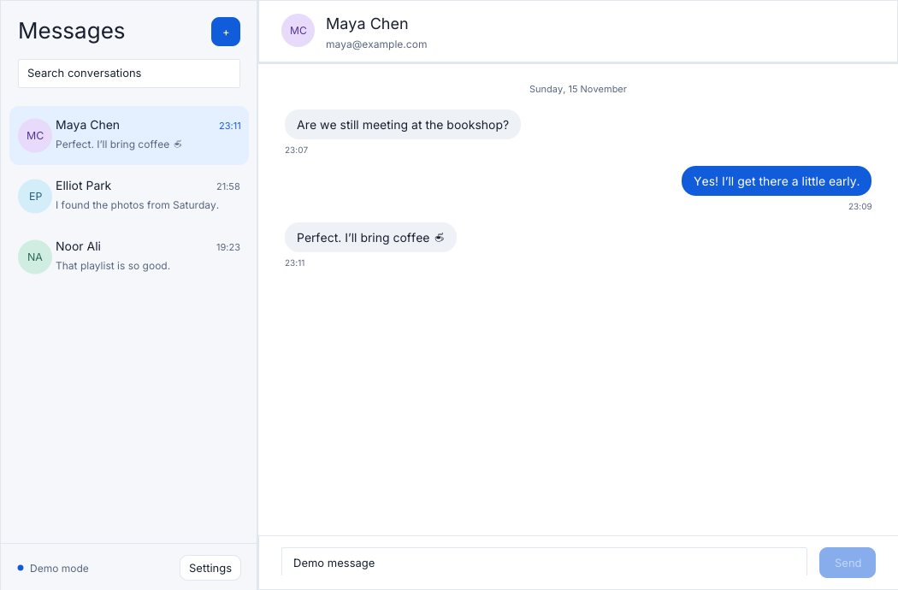

# Messages for Linux

A macOS Messages-inspired Linux desktop app, an optional self-hosted server, and an experimental Rust engine that talks directly to Apple's APNs and Identity Service (IDS). The desktop app can run the engine on the same computer or connect to the Rust server.



## Try the desktop app

Build on Linux with Rust 1.88 or newer, a C compiler, pkg-config, and the OpenSSL development headers. The desktop uses OpenGL on Wayland or X11. A desktop Secret Service provider, such as GNOME Keyring or KWallet with its Secret Service integration enabled, is required for desktop credential storage.

```sh
cargo build --locked --release
./target/release/messages --demo
```

Use **+** or **Ctrl+N** to start a conversation. Enter sends and Shift+Enter adds a line break. Demo mode uses local sample conversations and saves messages to a separate demo database.

## Connect to iMessage

The engine implements the Apple courier connection, IDS address lookup and legacy registration, and the legacy encrypted text format for one-to-one conversations. It uses an existing Apple device identity and validation credentials. Fresh Apple Account sign-in, 2FA, initial APNs activation, and hardware validation generation are still missing. Live registration and message delivery have yet to be verified with an Apple Account.

The [Apple provisioning guide](docs/apple-session.md) lists the materials and import formats. Once a session is stored in Secret Service, open **Settings → This computer**. The app will connect directly from Linux. This mode uses the engine inside the desktop app.

Supported message content is plain text exchanged with devices that accept the legacy format. Group chats, attachments, SMS, modern iMessage encryption formats, and iCloud history sync remain outside this version. The UI shows when Apple's courier accepted a send. Recipient delivery and read receipts require further work.

## Run the optional server

Build just the server for a headless machine.

```sh
cargo build --locked --release --no-default-features --bin messages-server
./target/release/messages-server --data-dir ./server-data serve --demo
```

In the desktop app, choose **Settings → Server** and enter `http://127.0.0.1:7848`. Leave the login fields blank for this local demo. To serve Apple messages, provision the server's data directory and start it without `--demo`. Only one process can open a given local profile. If the server owns the profile, connect the desktop through **Server** mode.

For a network listener, supply a TLS certificate and key and require a username and password. The certificate must match the hostname and chain to a CA trusted by the Linux desktop.

```sh
./target/release/messages-server --data-dir ./server-data set-password --username finn
./target/release/messages-server --data-dir ./server-data serve \
  --bind 0.0.0.0:7848 --require-login \
  --tls-cert /path/to/fullchain.pem --tls-key /path/to/server.key
```

In **Settings → Server**, enter the HTTPS origin and the same username and password. **Remember password** saves the password to Linux Secret Service. The server stores a salted Argon2id password hash and accepts one account with access to the entire profile. HTTP access is limited to loopback. The server can also require the login on loopback by using `--require-login`.

## Storage and verification

The Apple session is stored in Linux Secret Service or in an AES-256-GCM vault with a separate 32-byte key on a headless server. The desktop settings file contains the connection mode, server URL, and username. Decrypted conversation history is stored in SQLite under the private data directory. A server operator with access to that directory or the running server can read the history.

```sh
cargo test --locked --all-targets
cargo clippy --locked --all-targets -- -D warnings
```

The repository contains the Rust engine source. Protocol references are [Apple Platform Security](https://support.apple.com/guide/security/how-imessage-sends-and-receives-messages-sec70e68c949/web), [NowSecure's APNs research](https://www.nowsecure.com/blog/2021/01/27/reverse-engineering-imessage-leveraging-the-hardware-to-protect-the-software/), and [the RustPush protocol implementation](https://github.com/OpenBubbles/rustpush/tree/b3c96c23e1aae78d1229ebaccb12027624f1eaff). The bundled public roots are supplied by [Apple's Certificate Authority](https://www.apple.com/certificateauthority/). [Inter is distributed under the SIL Open Font License](assets/Inter-OFL.txt).
